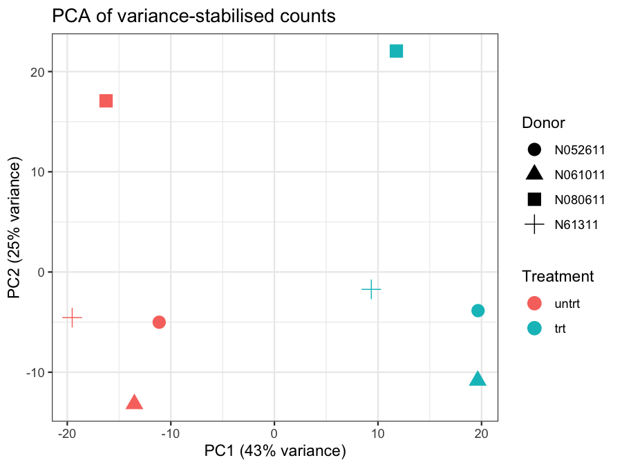
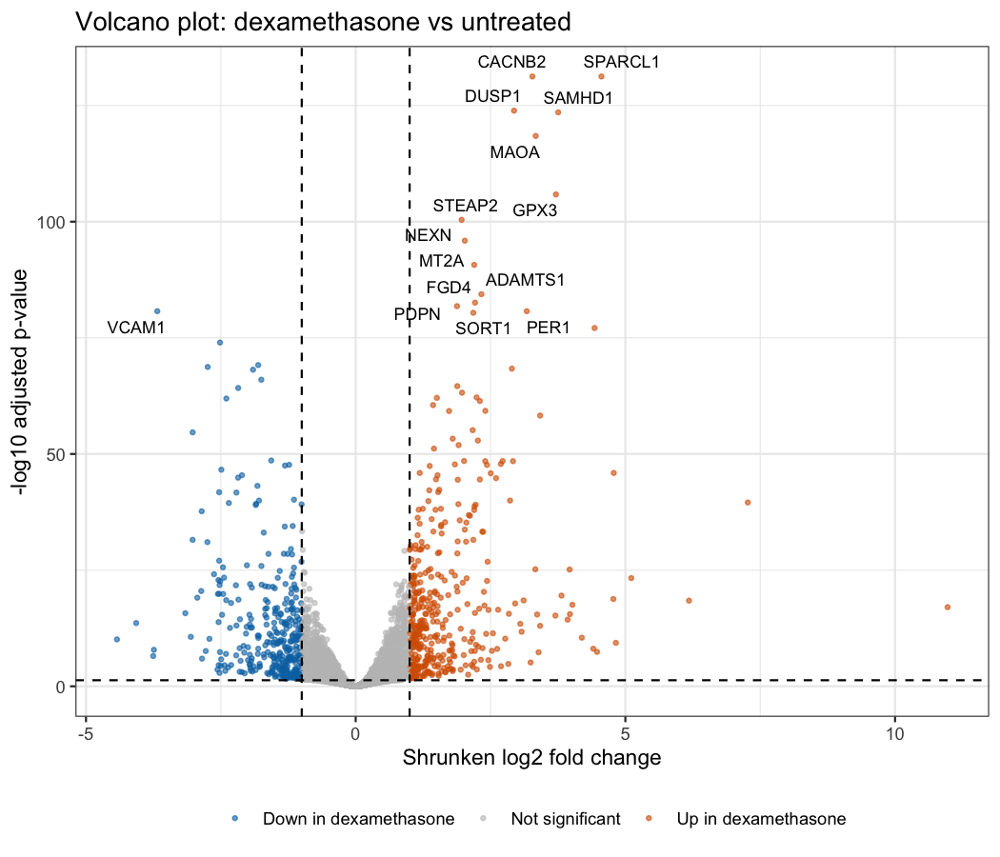
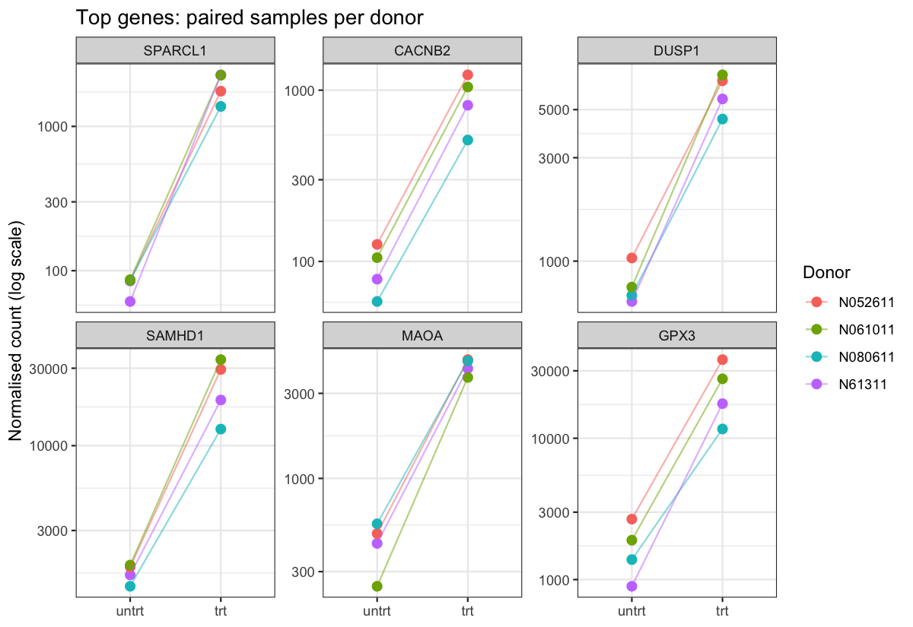

# How Does Dexamethasone Reprogram Airway Smooth Muscle Cells? An RNA-seq Analysis

Differential gene expression analysis of human airway smooth muscle cells treated with the glucocorticoid dexamethasone, using DESeq2 in R.

## Question

Glucocorticoids such as dexamethasone are a first-line treatment for asthma, yet how they act on airway smooth muscle at the level of gene expression is only partly understood. This project asks: **which genes change expression when airway smooth muscle cells are treated with dexamethasone, and which biological processes do they point to?**

## Data

The [`airway`](https://bioconductor.org/packages/airway/) Bioconductor dataset, derived from [Himes et al. (2014), *PLoS ONE*](https://doi.org/10.1371/journal.pone.0099625) (GEO: [GSE52778](https://www.ncbi.nlm.nih.gov/geo/query/acc.cgi?acc=GSE52778)).

- 8 RNA-seq samples from 4 human donors (cell lines)
- Each donor: one untreated sample and one sample treated with 1 µM dexamethasone for 18 hours
- Gene-level read counts for ~64,000 Ensembl genes

Because every donor contributes both a treated and an untreated sample, the design is **paired**, which lets the analysis separate the drug effect from donor-to-donor differences.

## Methods

| Step | Script | What it does |
|------|--------|--------------|
| 1 | `01_load_and_qc.R` | Load counts, filter low-count genes, check library sizes, PCA and sample clustering on variance-stabilised data |
| 2 | `02_differential_expression.R` | DESeq2 with design `~ cell + dex`, apeglm fold-change shrinkage, gene symbol annotation |
| 3 | `03_visualization.R` | MA plot, volcano plot, heatmap of top genes, paired per-donor count plots |
| 4 | `04_pathway_enrichment.R` | Gene Ontology (Biological Process) enrichment with clusterProfiler, run separately for up- and down-regulated genes |

Significance threshold: adjusted p-value (Benjamini–Hochberg) < 0.05 and |log2 fold change| > 1 (at least a 2-fold change).

## Key findings

<!-- Fill these in from YOUR results after running the analysis. -->

**Sample QC.** [Describe the PCA: what does PC1 separate? What does PC2 separate? Does treatment or donor explain more variation?]



**Differential expression.** [X] genes were significantly differentially expressed: [X] up-regulated and [X] down-regulated in dexamethasone-treated cells.



**Top genes.** [Name 3–5 of the top genes and what is known about them. Do any match known glucocorticoid-response genes reported by Himes et al.?]



**Pathways.** [Summarise the main GO terms among up- and down-regulated genes, and whether they make biological sense for a glucocorticoid.]

## How to reproduce

```bash
git clone https://github.com/abdullahikrambutt/rnaseq-dexamethasone-airway.git
cd rnaseq-dexamethasone-airway

# Option A: conda
conda env create -f environment.yml
conda activate rnaseq-airway

# Option B: plain R
Rscript install_packages.R

# Run everything (a few minutes on a laptop)
Rscript run_all.R
```

Figures are saved to `figures/` and result tables to `results/`.

## Project structure

```
├── scripts/
│   ├── 01_load_and_qc.R
│   ├── 02_differential_expression.R
│   ├── 03_visualization.R
│   └── 04_pathway_enrichment.R
├── figures/          # all plots
├── results/          # DE tables and GO enrichment tables
├── run_all.R
├── environment.yml
└── install_packages.R
```

## Limitations and next steps

- Only 4 donors, so statistical power is limited and results may not generalise.
- One dose and one time point; a time course would show which changes are direct and which are downstream.
- Gene-level counts were taken as given; a full pipeline would start from raw FASTQ reads (quality control, alignment or pseudo-alignment, quantification).
- [Add your own idea, e.g. comparing results with a different method such as edgeR or limma-voom.]

## About this project

This is a self-directed learning project to practise a complete bulk RNA-seq differential expression workflow. It follows established community resources:

- Love, Anders & Huber. [DESeq2 vignette](https://bioconductor.org/packages/release/bioc/vignettes/DESeq2/inst/doc/DESeq2.html)
- Love et al. (2016). [RNA-seq workflow: gene-level exploratory analysis and differential expression](https://bioconductor.org/packages/rnaseqGene/), *F1000Research*
- Harvard Chan Bioinformatics Core. [DGE workshop](https://github.com/hbctraining/DGE_workshop)

## License

MIT
